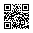

<!--
EDITING GUIDE (for coauthors)
- Change words anywhere below. Keep the ::: lines; they place each block on the page.
- "# Heading" is a panel title. "## Heading" is a sub-heading inside a panel.
- ::: {.carleton} and ::: {.ucla} tag an example with its school.
- Student outcome numbers live in data/outcomes.csv (category,count). The chart redraws itself.
- Do not edit typst-template.typ unless you want to change the layout.
- Build:  quarto render poster.qmd   (writes poster.pdf)
- Open a PR for changes; Tim or Paula merges.
-->

::: {.cells columns="1fr 2fr" gutter="70pt"}

::: {.cell}
::: {.lede}
Paid students contribute to research and build RSE skills while they do it.
:::

Campuses need more data and software help than staff can provide. Courses leave gaps, and so does the code researchers write. DataSquads fill those gaps.
:::

::: {.cell}
```{=typst}
#model-diagram()
```
:::

:::

::: {.cells columns="1fr 1.3fr 1fr" gutter="70pt"}

::: {.cell}
# A paid job that teaches

Many students never hear of these opportunities, especially students from underrepresented groups. Students work for the library or a department, and staff supervise them. Students help researchers with their data, from cleaning to reproducibility.

## Who is on a DataSquad

```{=typst}
#roles()
```

## Limits we keep

We help with a researcher's data and code. We don't change their research questions, tutor their students, or share anything a researcher tells us in confidence.

## Pace of work

Student schedules, the academic calendar, onboarding, review, and graduation handoffs contribute to the cycles and pace of work. More students can take more varied projects, but need more oversight. Handbooks, templates, and staff stay when students graduate.
:::

::: {.cell}
# What the work looks like

::: {.carleton}
**Election-news scraper.** Seven students built it in 2022. Two more extended it from 2023 to 2024 for a political science project that involved over 500,000 transcripts.

```{=typst}
#relay()
```
:::

```{=typst}
#heli-example[*Police helicopter flight data.* Two students brought software skills to a research lab's R code. They refactored it with staff, and the code went through code review. Loading the data fell from about 318 minutes to about 2.]
```
<!-- TODO Paula: confirm the scraper figures (7 + 2 students, 2022 to 2024, 500,000+ transcripts) against the ITS blog post and pick/approve this as the Carleton example. Dashboard, wbcheck, and UC OSPO paragraphs were cut to make room for two examples with visuals; wbcheck and OSPO credit moved into the habits paragraph.
     TODO confirm before merge (Tim, with Lawrence, Maddie, and the staff involved): the 318 to ~2 minute figure (source: UCLA DSC Sway, 2025), who did the refactor and review, and the lab's OK to include it. The website entry says "over 800%" and names other students; reconcile or pick one. Image: no photo used; rights unknown. UC OSPO Education site paragraph was removed from here; text kept in git history (PR #10 branch). -->

```{=typst}
#v(30pt)
```


**Research software habits, when the project needs them.** Run instructions, a dependency list, one test, and a citation file. We do not treat them as a checklist. We plan to track whether researchers keep them. Two student-built projects have citation files and DOIs that credit their developers: wbcheck ([doi:10.5281/zenodo.23329531](https://doi.org/10.5281/zenodo.23329531)) and the UC OSPO Education site ([doi:10.5281/zenodo.23330022](https://doi.org/10.5281/zenodo.23330022)).
:::

::: {.cell}
# Where students go next

We located 19 former UCLA student employees. Their current job categories, from public profiles in 2026:

```{=typst}
#outcomes-list("data/outcomes.csv")
```

Descriptive, not a placement rate.

# What adopting takes

- Student positions and a wage budget
- Supervisors and mentors with time to review and coach
- Onboarding and a home for documentation
- A plan for turnover

::: {.startbox}
# Start a DataSquad

::: {.cells columns="1fr 2.2in" gutter="30pt"}

::: {.cell}
Get the starter kit for roles, onboarding, confidentiality, and request tracking. Students learn software sharing from our open lesson, [Sharing Research Software](https://ucospo.net/research-software-citable-discoverable/). Supervise students? Compare onboarding, review, and graduation handoffs with us.

::: {.url}
[datasquad.info/join](https://datasquad.info/join)
:::
:::

::: {.cell}
::: {.block fill="white" inset="0pt" radius="4pt"}
{width=2.2in}
:::
:::

:::
:::
:::
:::

<!-- TODO Paula: confirm we can offer sample job descriptions (Start one promises them).
     TODO Paula: pick the two Carleton examples; both have public sources on datasquad.info/projects.
     TODO Tim: helicopter flight data example left out until details are confirmed with the people involved.
     TODO: confirm UCLA cohort size and weekly hours before adding them to panel 1.
     TODO: add Carleton alumni counts to data/outcomes.csv, or keep the chart UCLA only. Freeze decision: Oct 14.
     TODO: student quote and photo slot, only with written consent for print and the public Zenodo PDF. Ask by Oct 14. -->
